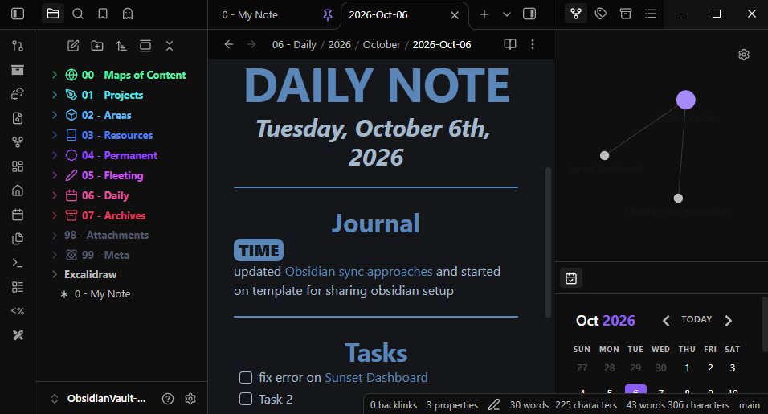
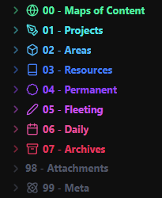
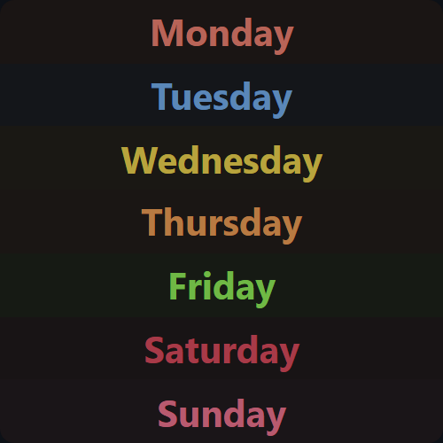
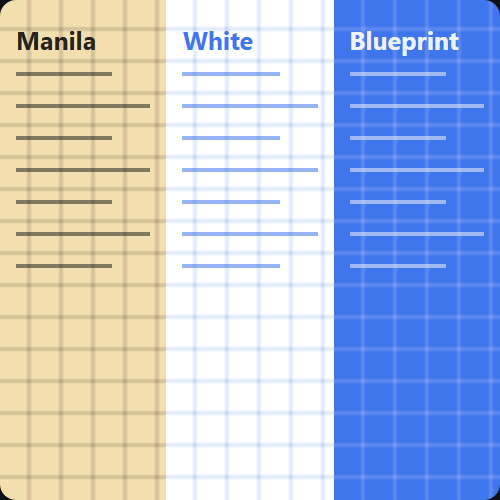
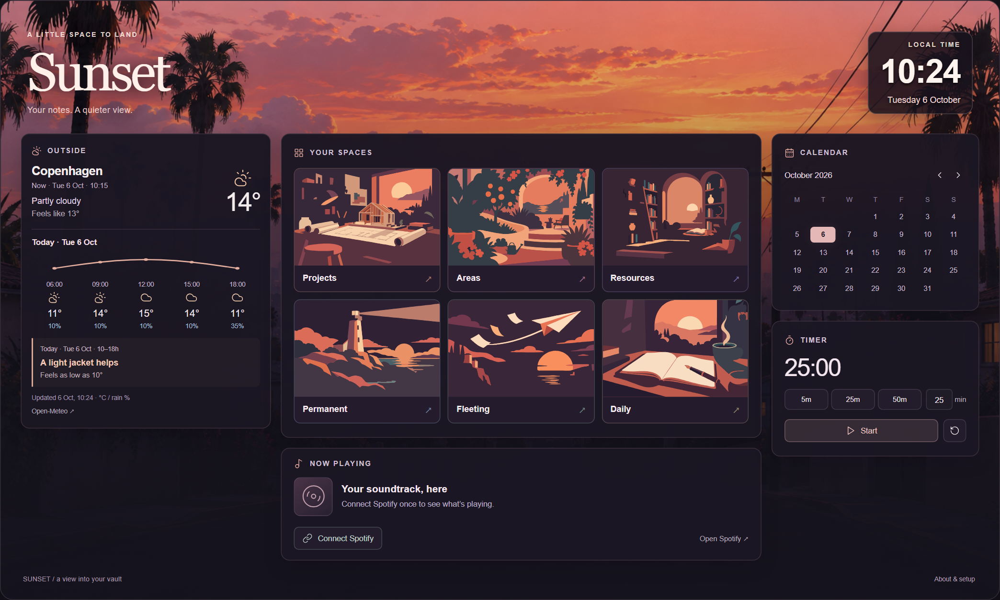
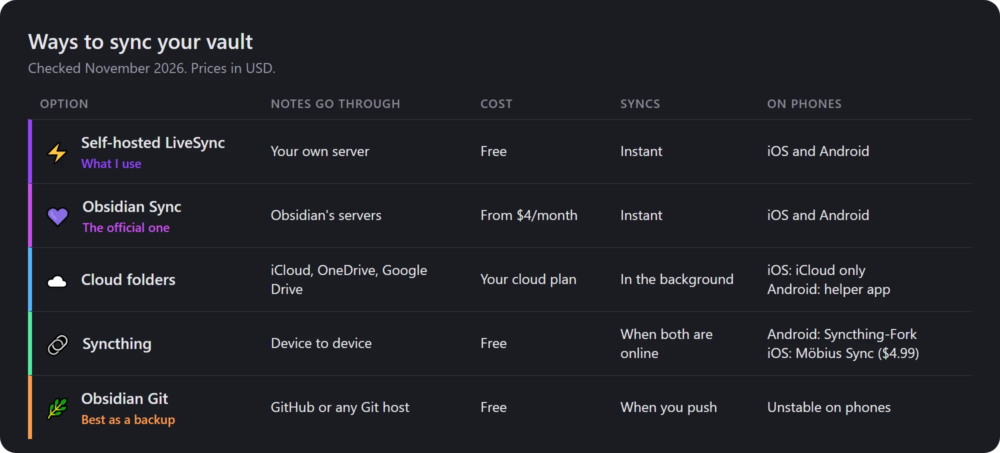
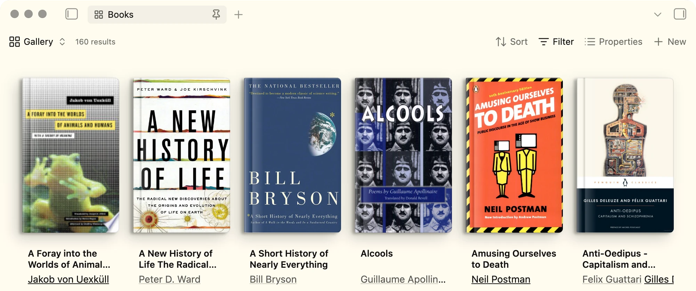

# Birckk Obsidian Template

A colorful Obsidian vault you can download and start writing in.

My own vault, with a customized daily note and the optional Iconize and Calendar plugins.

## What's in here

The vault works on its own. The rest is optional.

| Part | What it is |
| --- | --- |
| 🎨 **[The look](#the-look)** | Colored folders and weekday notes. No plugins needed. Styling by [CyanVoxel](https://github.com/CyanVoxel). |
| 🌴 **[Sunset Dashboard](#sunset-dashboard)** | A start page with folder cards, weather, a calendar and a timer. |
| 🔄 **[Syncing](#syncing)** | What I use, and the other ways to get a vault onto all your devices. |
| 📚 **[Book covers](#book-covers)** | Your book notes as a shelf of hardcovers. |
| 🧩 **[Appearance and plugins](Vault/99%20-%20Meta/Appearance.md)** | What each style does, and when each plugin is useful. |
| 💡 **[Ideas and credits](Vault/99%20-%20Meta/Credits.md)** | Videos, posts and setups I learned from. |

## The look

<table>
<tr>
<td align="center" valign="top"> 🌈 <b>Colored folders</b></td>
<td align="center" valign="top"> 📅 <b>Weekday colors</b></td>
<td align="center" valign="top"> 📓 <b>Notebook paper</b></td>
</tr>
</table>

Folder icons come from the optional Iconize plugin. The styling comes from [CyanVoxel's vault template](https://github.com/CyanVoxel/Obsidian-Vault-Template), so go check it out.

## Sunset Dashboard

It needs the Dataview plugin. See the [setup guide](Vault/99%20-%20Meta/Dashboard/README.md).

## Syncing

Pick one. Running two over the same vault can cause conflicts.

- ⚡ Plugin based: 
    - Self-hosted [LiveSync](https://github.com/vrtmrz/obsidian-livesync): What I use, and it works well. Changes sync instantly through your own server. 
    - Online-storage [Remotely Save](https://github.com/remotely-save/remotely-save) uses cloud storage you already have, but it hasn't been updated since October 2024.
- 💜 [Obsidian Sync](https://obsidian.md/sync): the official paid service, from $4 a month.
- ☁️ Cloud folders: OneDrive, iCloud, Google Drive and so on. I've never properly tested these, so read [Obsidian's guide](https://obsidian.md/help/sync-notes) first.
- 🔗 [Syncthing](https://syncthing.net/): copies files directly between devices. Colleagues and friends have had good success with it, but the official Android app is gone. Use Syncthing-Fork on Android and Möbius Sync on iOS.
- 🌿 [Obsidian Git](https://github.com/Vinzent03/obsidian-git): Good for version history/backups and can be combined with other approaches. Its own README warns that it's unstable on phones. 
    - But I like instant syncing between phone <-> pc, so I don't use it for sync.

## Book covers

Screenshot from [kepano's gist](https://gist.github.com/kepano/8afc4cad9c32f4fde6ef6347f66a0571).

kepano, Obsidian's CEO, wrote [a small CSS snippet](https://gist.github.com/kepano/8afc4cad9c32f4fde6ef6347f66a0571) that turns a Bases card view into hardcover books ([Reddit post](https://www.reddit.com/r/ObsidianMD/comments/1ogpxtg/hardcover_book_effect_for_card_view/)). I use it for my own books: each note gets a tag and a `cover` image property, and a Base shows them as cards. The snippet isn't in this template, so grab it from the gist.

## Try it

1. 📦 [Download the ZIP](https://github.com/Bircck/Birckk-ObsidianTemplate/archive/refs/heads/main.zip), extract it, and copy **Vault** to where you keep your notes.
2. 📂 In Obsidian, choose **Open folder as vault** and select **Vault**.
3. 👋 Open **Start here**.

## Credits

This started with [CyanVoxel's vault template](https://github.com/CyanVoxel/Obsidian-Vault-Template). [CyanVoxel's videos](https://www.youtube.com/@CyanVoxel/videos) are awesome, go watch them.  
The dashboard layout was inspired by [InlitX / Komorebi](https://github.com/InlitX/Obsidian-Dashboard-Gallery).

[All credits](Vault/99%20-%20Meta/Credits.md) · [MIT license](LICENSE) · [Third-party notices](THIRD-PARTY-NOTICES.md)
